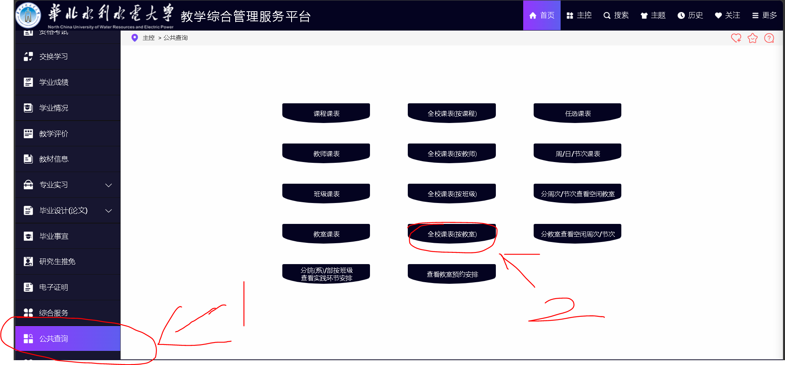
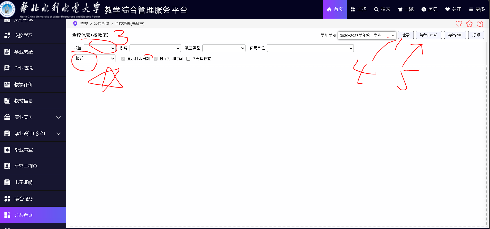
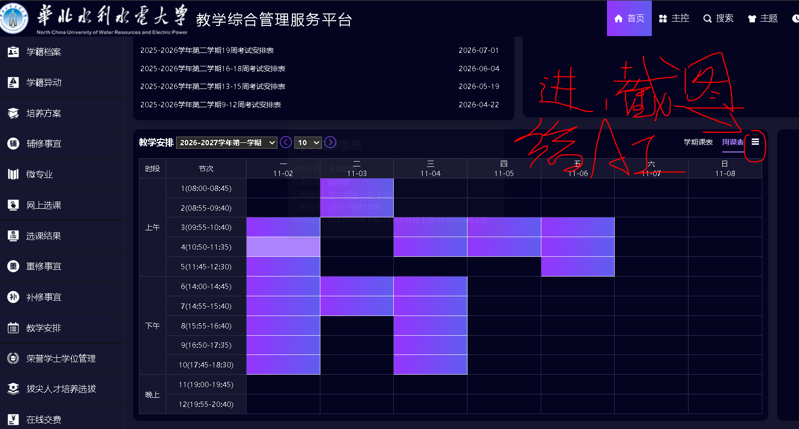

# NCWU-Course-Auditor
> 华水（NCWU）全校课表检索与蹭课辅助系统

## 📖 项目简介
`NCWU-Course-Auditor` 是一个基于 Streamlit 开发的本地 Web 应用，旨在解决**想蹭课却不知道什么时间、哪个教室有感兴趣的课**的痛点。

通过导入学校教务系统（青果系统）导出的「全校课表（按教室）」数据，本系统能够快速将庞杂的课表数据整理为可交互的检索网格，自动检测时间冲突，并帮助你一键筛选出你有空且感兴趣的课程。

## ✨ 核心特性
- 🔍 **智能搜索**：支持按课程名称、教师姓名进行模糊检索，自带下拉预测，帮你快速锁定目标。
- 📅 **多维度筛选**：支持周次（多选）、星期几（多选）、节次范围的自由组合筛选，精确找到你的空闲时间段。
- 🚨 **冲突自动检测**：内置个人课表配置，系统会自动标红与你已有课程时间重合的蹭课目标。
- 🙈 **纯净模式**：一键隐藏所有时间冲突的课程，只展示「随时能去」的蹭课选项。
- 🚫 **旷课屏蔽模式**：支持在侧边栏选择你想"旷掉"的课程。系统会自动识别课程主干名称（自动忽略课程名后的括号及数字，如将"高等数学(1)"识别为"高等数学"），不仅会消除该时段的冲突提示，还会将全校所有该课程直接隐藏，还你一个清净的蹭课列表。
- 🎓 **行政班级展示**：在展开的课程卡片中，新增了"上课班级"字段的展示，你可以清楚看到这门课是哪个专业、哪个班级在上，方便评估是否适合自己旁听。
- ⏰ **时间直观映射**：自动将教务系统的「第X-X节」转换为具体的起始时间，并清晰展示课程所在的教室。
- 🗂️ **一键收起/展开视图**：在页面顶部提供全局控制按钮。点击"一键收起"后，所有课程卡片会变为极简单行排版（仅保留课程名、教师、教室、节次和状态），极大提升屏幕利用率，方便快速扫视浏览大量课程。

## 🚀 快速开始
### 1. 环境准备
请确保你的电脑已安装 **Python 3.8 或更高版本**。

### 2. 克隆本项目
在终端中执行以下命令将项目下载到本地：
```bash
git clone https://github.com/danvric/ncwu-course-auditor.git
cd ncwu-course-auditor
```

### 3. 安装依赖
使用 `pip` 安装项目所需的第三方库：
```bash
pip install pandas openpyxl streamlit
```

### 4. 准备数据
1. 登录华北水利水电大学教务系统（青果系统）
2. 依次点击：`公共查询` → `全校课表(按教室)`
3. 筛选好学期后，点击「导出Excel」按钮
4. 将下载的文件重命名为 `教室课表.xlsx`，并放置于项目根目录

> 💡 注意：如果你导出的文件是 `.xls` 格式，请先使用 Excel 或 WPS 打开并另存为 `.xlsx` 格式。




### 5. 配置个人课表
打开 `app.py` 文件，找到名为 `MY_SCHEDULE` 的字典。根据你自己的真实课表，修改其中的冲突时间段。

> 焚决：不知道怎么写可以把你的课表截图给AI，然后把app.py发给AI，然后他帮你填


### 6. 启动应用
在终端中执行以下命令：
```bash
python -m streamlit run app.py
```
程序会自动在浏览器中打开 `http://localhost:8501/`，即可开始使用。

## 📂 目录结构
```text
ncwu-course-auditor/
├── app.py                  # 核心程序代码，包含数据清洗、冲突检测与界面渲染逻辑
├── 教室课表.xlsx            # 教务系统导出的原始数据（需自行下载，已被 .gitignore 忽略）
├── Material/               # 本地测试与素材文件夹（已被 .gitignore 忽略）
├── .gitignore              # Git 忽略配置，防止敏感数据和缓存被上传
├── CONTRIBUTING.md         # 贡献指南，说明如何参与项目开发
├── CODE_OF_CONDUCT.md      # 社区行为准则
├── LICENSE                 # 开源协议文件
└── README.md               # 说明文档
```

## ⚠️ 免责声明
本工具仅供个人学习和辅助蹭课使用，请勿用于任何商业用途或恶意爬取教务系统。
使用过程中请遵守学校相关网络规定，控制访问频率。
切勿将教务系统导出的原始数据（包含学生名单、学号等隐私信息）上传至任何公共仓库。

## 📜 开源协议
本项目采用 **MIT License** 开源。

---